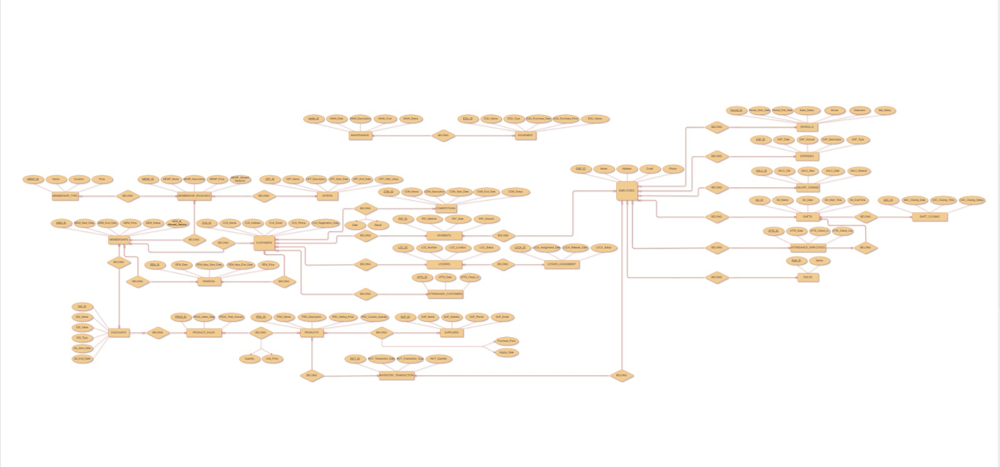
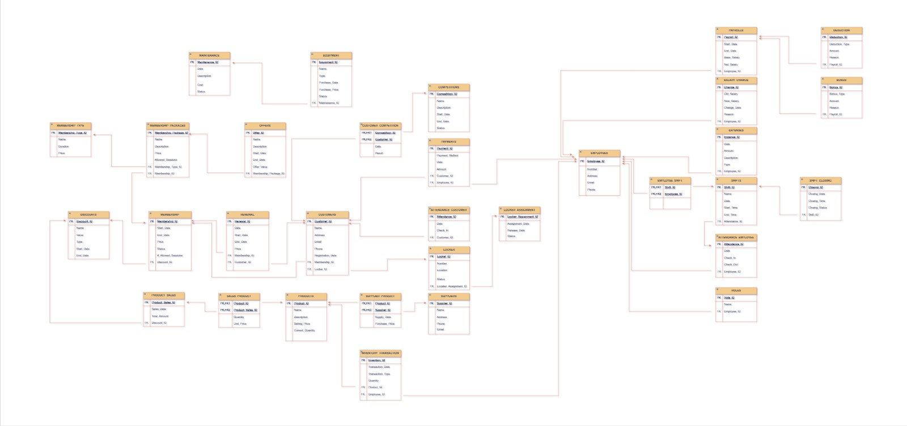

# Gym Management System Database

A complete relational database design for a gym management system, built end to end: requirements analysis, conceptual ERD, relational mapping, and a full SQL Server DDL implementation.

## What the system covers

The database manages the gym's daily operations:

- **Customers** and their attendance
- **Employees**, roles, shifts, and attendance
- **Memberships**: types, packages, offers, discounts, and renewals
- **Sales**: products, suppliers, product sales, and inventory transactions
- **Equipment** and maintenance records
- **Facility**: lockers and locker assignments
- **Competitions** and customer participation
- **Finance**: payments, expenses, salary changes, and payroll

## Design process

1. **Requirements** - full software requirements specification (`docs/gym_srs.docx`)
2. **Conceptual design** - ER diagram with entities, relationships, keys, cardinality and participation constraints
3. **Logical design** - relational mapping of the ERD into tables with primary and foreign keys
4. **Physical design** - T-SQL DDL script creating the database on SQL Server

## Diagrams

### Entity-Relationship Diagram


### Relational Mapping


## Database structure

32 tables organized into 9 schemas:

| Schema | Tables |
|---|---|
| `HR` | EMPLOYEES, ROLES, ATTENDANCE_EMPLOYEE, SALARY_CHANGE, PAYROLLS, DEDUCTION, BONUS |
| `Membership` | MEMBERSHIP_TYPE, MEMBERSHIP, MEMBERSHIP_PACKAGES, OFFERS, DISCOUNTS, RENEWAL, CUSTOMERS, ATTENDANCE_CUSTOMER |
| `Operations` | SHIFTS, EMPLOYEE_SHIFT, SHIFT_CLOSING |
| `Inventory` | PRODUCTS, SUPPLIERS, SUPPLIER_PRODUCT, INVENTORY_TRANSACTION |
| `Sales` | PRODUCT_SALES, SALES_PRODUCT |
| `Equipment` | Equipment, Maintenance |
| `Facility` | LOCKER, LOCKER_ASSIGNMENT |
| `Competition` | COMPETITIONS, CUSTOMER_COMPETITION |
| `Finance` | PAYMENTS, EXPENSES |

## Repository contents

| Path | Description |
|---|---|
| `database/gym_ddl.sql` | Full DDL script: schemas, tables, constraints, and relationships |
| `design/drawio/` | Editable draw.io source files for the ERD and mapping diagrams |
| `docs/gym_srs.docx` | Software requirements specification |
| `images/erd.jpg` | Exported ER diagram |
| `images/mapping.jpg` | Exported relational mapping diagram |

## How to run

1. Create the database in SQL Server:

```sql
CREATE DATABASE GYM;
GO
```

2. Run `database/gym_ddl.sql`. It creates the schemas, all tables, primary keys, foreign keys, and check constraints.

## Tools

- **SQL Server / T-SQL** - DDL implementation
- **draw.io** - ERD and relational mapping diagrams

## Author

**Mohamed Helal** - Data Analyst & Database Developer
